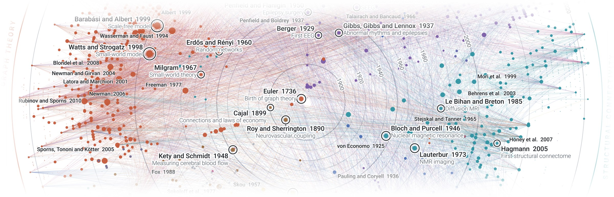
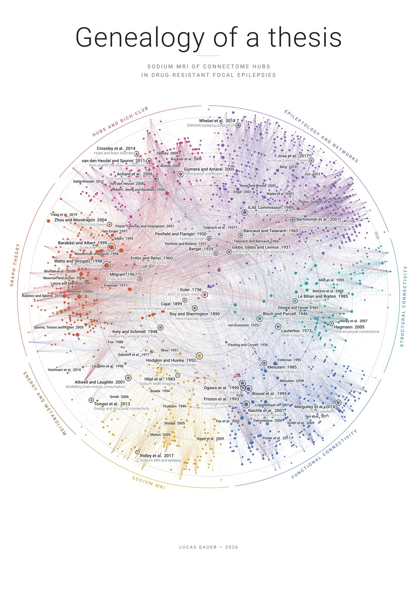

# Knowledge Ancestry

**Genealogy of the ideas from a Zotero library.**

Each node is a science paper, placed on the ring of its publication year (time flows from the centre to the edge) and in the sector of its theme. Each edge links a work to one of its sources (by citation). Node size follows the total number of citations of the paper, and a few founding works, the *milestones*, are circled and captioned with what they brought to the field.

I vibe-coded these scripts with Claude Opus 5.5 to get a nice poster to illustrate my PhD thesis. Some friends asked for it, so here it is. The full figure is shown [at the end of this page](#example).

## Quick start

```bash
pip install -r requirements.txt
python etape1_recuperer.py my_library.csv --email you@example.org --langue en
#   edit config.json: name the themes, describe the milestones
python etape2_dessiner.py --mode tout
python etape3_animer.py          # optional video
```

Figures are written to `sortie/`. A first figure takes about half an hour, most of it spent waiting for the servers to get the citations and choosing milestones.

> **A note on language.** Script names, command-line options, configuration keys and code comments are in French, which is how this kit was first shared. The figure itself can be drawn in English (`"langue": "en"`), and this page translates every option you need.

## Requirements

- Python 3.9 or later, with `numpy`, `matplotlib` and `networkx` (installed by `requirements.txt`).
- Optional: `fa2_modified` (ForceAtlas2), which gives a cleaner ordering of works within each sector. If it fails to install, which happens on some Windows set-ups, remove it from `requirements.txt`: the scripts fall back on networkx.
- Optional, for the video: [ffmpeg](https://ffmpeg.org) (`winget install ffmpeg`, `brew install ffmpeg` or `sudo apt install ffmpeg`). Without it, the animation can be written as a GIF.

No account and no API key are needed. On Windows, type `py` instead of `python` if the latter is not recognised.

## 1. Export your library from Zotero

Right-click a collection (or *My Library*), choose *Export Collection…*, then **CSV**, the simplest format. BibTeX, RIS and CSL JSON also work.

Only entries with a **DOI** are used as starting points, because the DOI is how Crossref finds each article's reference list. Works *cited* by your articles appear in the figure whether or not they have a DOI. Libraries of 100 to 800 articles give the best results; beyond that, the figure becomes dense and fetching takes longer.

## 2. Fetch the citations

```bash
python etape1_recuperer.py my_library.csv --email you@example.org --langue en
```

The script asks [Crossref](https://www.crossref.org) for the reference list of each of your articles, then asks [OpenAlex](https://openalex.org) for the citation count, authors, year and type of every work kept. It also reads the references of the most cited works in each theme, to recover common ancestors that your own articles do not cite directly. Expect 5 to 15 minutes for 300 articles.

A work becomes a dot when at least three articles of your library cite it. Works cited once or twice form the background *dust*, thousands of small grains that give the rosette its texture.

Every server response is cached in `cache/`. After a network failure, run the same command again: it resumes where it stopped. Once everything is cached, a rerun takes a few seconds.

| option | meaning |
|---|---|
| `--email` | your address, sent to Crossref for faster and more reliable access (never written to disk) |
| `--langue en` | write an English starting `config.json` (French by default) |
| `--min-citations 3` | minimum number of citing articles for a work to become a dot |
| `--themes-max 7` | maximum number of themes |
| `--resolution 1.0` | community detection resolution: higher gives more themes |
| `--hubs 5` | per theme, number of influential works whose references are also read |
| `--hors-ligne` | offline: use the cache only |
| `--cle-openalex` | optional OpenAlex API key (not needed) |

The script writes three files:

| file | content |
|---|---|
| `graph.json` | the citation graph (do not edit) |
| `config.json` | figure settings, **to be edited** |
| `candidats.txt` | the 20 most influential works of each theme, to help you pick milestones |

## 3. Edit `config.json`

This is where the figure is made. Any text editor will do; mind the JSON syntax (straight quotes, a comma between items, none after the last one). If the file is invalid, the scripts report the line and column. A complete example is given in [`exemples/config_exemple.json`](exemples/config_exemple.json).

| key | meaning |
|---|---|
| `langue` | `"fr"` or `"en"`: "Watts et Strogatz" becomes "Watts and Strogatz", and "vous êtes ici !" becomes "you are here!" |
| `titre`, `sous_titre`, `signature` | title, one or two subtitle lines, and footer (poster, and A4 with `--titre`) |
| `themes` | `[{"id": 0, "nom": "Graph theory", "couleur": "#C65A3B"}, ...]`; list order is the clockwise order of sectors from twelve o'clock |
| `fusionner` | merge themes: `{"5": 2}` pours theme 5 into theme 2 |
| `jalons` | milestones: `{"id": "10.1038/30918", "nom": "Watts et Strogatz", "quoi": "Small-world model"}` |
| `toujours_nommer` | IDs that must always be labelled |
| `jamais_nommer` | IDs that must never be labelled (reviews, editorials) |
| `outils` | software, atlases and statistical tests, by DOI (`ids`) or first-author surname (`noms`): never labelled, and sized by your library only |
| `renommer` | fix a label: `{"10.1017/cbo9780511815478": "Wasserman et Faust"}` |
| `annee_centre` | year at the centre (computed by default) |
| `mes_articles` | DOIs of your own papers, for the "you are here" version |

**Themes.** They are communities of the citation graph, that is, groups of works that cite each other more than they cite the rest. Each one receives a provisional name made of the three most frequent words in its titles ("sodium · brain · imaging"): replace it with a short name (under 30 characters, or it will overflow its arc). Put neighbouring fields side by side; threads will be easier to follow.

**Milestones.** The script proposes three per theme with an empty `"quoi"`. Fill it in, remove those that do not speak to you, and add your own from `candidats.txt`. A few rules of thumb from my own attempts: a descriptor of two to five words with no leading article ("Small-world model", not "The small-world model"); the original article rather than the review that popularised it (`candidats.txt` flags reviews); about twenty milestones in total, thirty at most.

A milestone can also be a **precursor** missing from Crossref, such as an old book or a pre-DOI article. Give it an invented key starting with `u:`, a year, a theme, and the works of your graph that cite it; the citation count is optional and sets the dot size:

```json
{"id": "u:euler:1736", "nom": "Euler", "annee": 1736, "quoi": "Königsberg bridges", "theme": 2,
 "cite_par": ["10.1038/30918"], "citations": 5000}
```

**Your own papers.** After adding DOIs to `mes_articles`, **rerun step 1** (a few seconds thanks to the cache) so that their references are fetched. Your papers are then removed from the body of the rosette and drawn apart, in black, linked in grey to the works they cite.

## 4. Draw

```bash
python etape2_dessiner.py --mode tout
```

| command | output |
|---|---|
| `--mode a4` | A4 portrait, no title, footer signature (default) |
| `--mode a4 --titre` | A4 with title, subtitle and signature |
| `--mode poster` | A1 poster (59.4 × 84.1 cm) with title, subtitle and signature |
| `--mode impression` | 19 cm square with no surrounding text, lines and dust strengthened for small print |
| `--mode diapo` | 16:9 slide background, rosette on the right, milestones only |
| `--mode nue` | square, no text at all |
| `--ici` | adds your papers and the "you are here!" note (with `a4`, `poster` or `impression`) |
| `--mode tout` | every version, plus the "you are here" ones when `mes_articles` is filled |

Each version is saved as PNG and PDF; the PDF is vector and is the file to send to a printer. Use `--dpi 100` for quick previews while tuning and `--dpi 600` for very fine print. `--etiquettes 5` changes the number of ordinary labels per theme (8 by default), and `--graine 7` gives another arrangement of dots within sectors if a group of milestones gets crowded.

Step 2 never contacts a server, so the usual workflow is a loop: draw a preview, look, edit `config.json`, draw again.

## 5. Animate (optional)

```bash
python etape3_animer.py
```

A 34-second 1080p video in which the current year always sits on the rim: works appear when they are published, then drift towards the centre as time passes, like tree rings seen from the bark. Milestones light up as they go by. Rendering takes 5 to 10 minutes. Options: `--secondes 20`, `--largeur 1280 --hauteur 720`, `--gif`.

## How the figure decides what to show

**Time scale.** In a recent bibliography, half of the works often date from the last fifteen years, and a linear scale would pile them up on the rim. The radius therefore blends linear time with rank in the corpus: busy decades are stretched, empty ones compressed, and chronological order is always preserved. Works older than the centre year are packed into a small central disc.

**Labels.** They are placed in this order: milestones, works listed in `toujours_nommer`, one label per first author, the largest dots, and finally a few isolated dots near the centre that would otherwise be puzzles. Under the "one author, one label" rule, each first author is named on their *earliest* work cited at least three times, rather than on their most cited one, so that the figure tells where ideas come from. A label never moves inwards from its dot, otherwise a 1998 article would look as if it had been published in 1985. Labels may cover ordinary dots, never a milestone ring or another label. When a milestone label cannot touch its ring, a short leader line joins them, and that line crosses no label, no other leader and no other ring.

## Troubleshooting

- **"jalon sans place" (milestone without room).** The area is too crowded: remove a neighbouring milestone, shorten its descriptor, or try another `--graine`.
- **A large unlabelled dot.** Its author is probably labelled elsewhere ("one author, one label"). Add it to `toujours_nommer` or to the milestones; if it is software or a statistical test, add it to `outils`.
- **A label such as "Unspecified", or a journal name instead of an author.** Fix it with `renommer` or silence it with `jamais_nommer`.
- **A misdated dot.** Reference lists contain typos, which OpenAlex corrects for works that have a DOI. For the others, add the work as a milestone with the right `annee`, or exclude it.
- **Meaningless themes.** Adjust `--resolution` in step 1, then merge themes in `config.json`. A new detection never overwrites your `config.json`: it is written to `config_proposee.json`, and theme numbers are kept as stable as possible.
- **Many articles "sans liste de références".** Some publishers do not deposit references with Crossref. The works they cite often still appear through your other articles.
- **429 errors.** The servers ask for a pause; the script waits and resumes on its own.

## Privacy

Your e-mail address is only sent to Crossref, in the request header and parameters, as Crossref recommends; it is never written to disk. The DOIs of your library are sent to Crossref and OpenAlex, and nothing else. The `cache/` folder only holds public metadata and can be deleted at any time. The `.gitignore` keeps your exports, cache, graph and settings out of version control.

## Repository layout

```
etape1_recuperer.py   step 1: Zotero export -> Crossref and OpenAlex -> graph.json, config.json, candidats.txt
etape2_dessiner.py    step 2: the rosette (A4, A1, 19 cm, 16:9 or bare, with or without "you are here")
etape3_animer.py      step 3: the video
outils.py             shared core: time scale, layout, threads, label placement
exemples/             a complete config.json
polices/              Roboto and Caveat fonts, with their licences
docs/                 images used on this page
```

## Example

The figure drawn for my thesis, as an A1 poster.



## Credits and licence

Scripts: [MIT licence](LICENSE), © 2026 Lucas Gauer.
Fonts: [Roboto](https://github.com/googlefonts/roboto) (Apache 2.0) and [Caveat](https://github.com/googlefonts/caveat) (SIL Open Font License 1.1), see `polices/`.
Data: [Crossref](https://www.crossref.org) and [OpenAlex](https://openalex.org) metadata, both released under CC0.

If you draw something with it, I would be glad to see it: feel free to open an issue with your figure.
